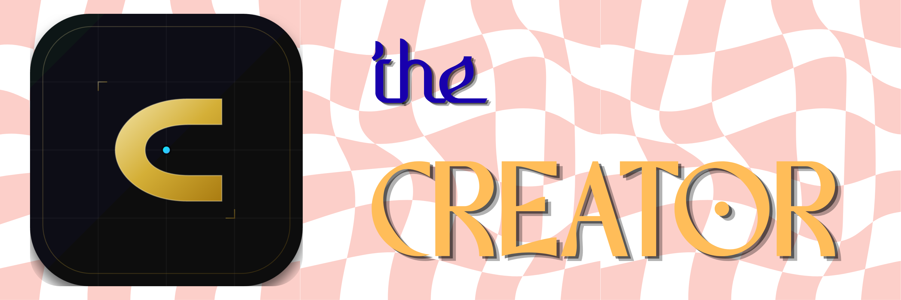

<div align="center">



**A tactical formation-building board game with no forced turn limit**

[](https://creator-game.onrender.com/)
[](https://www.python.org/)


**[Play online](https://creator-game.onrender.com/) · [Windows releases](https://github.com/dkconnect/Creator/releases) · [Source code](https://github.com/dkconnect/Creator)**

**Dibyanshu Kumar | October 2026**

</div>

---

# What is CREATOR?

CREATOR is a two-player strategy game on a **16 × 16 board**, with **32 pawns per team** and **53 selectable victory formations**. The goal is not to eliminate the opponent: it is to occupy **every required square of your team's target formation simultaneously**.

Both players use the same selected pattern in the same central area of the board, but **RED's target is vertically mirrored relative to BLUE's**. Depending on the pattern, the two sets of target squares can overlap, sometimes extensively. They are not necessarily identical. The game interface highlights the **current player's target formation**, switching when the turn changes.

A six-sided die determines the maximum distance for one move. Pawns can move in eight directions, jump over intermediate pieces, and capture an enemy at the destination. Captured pawns can return, so positional control matters more than permanent elimination.

> **Win by creating the formation.**


# The idea behind CREATOR

The original design question was: **what if a board game were won by creating a shape rather than capturing a king or clearing the board?**

That question changes how every square is valued. A square may matter because it is part of the final formation, because it blocks an opponent's approach, because it gives a pawn a useful landing point, or because taking it completes the last missing piece of a pattern. A capture can be valuable without permanently removing an enemy pawn. An apparently quiet move can be decisive if it secures the geometry of the target.

The die adds uncertainty without removing player agency. A roll does not prescribe one move; it establishes a range of distances. The player still decides **which pawn**, **which direction**, and **how far within that range**. That combination makes CREATOR part spatial puzzle, part tactical contest, and part game of adapting to chance.

The title reflects the central objective: **create the required formation under opposition**. A player cannot win by merely capturing more pawns or holding a majority of the required cells.

## What makes the game distinct

- **Formation is the victory condition.** Every required square matters.
- **The target changes by team.** RED sees a vertically mirrored version of BLUE's selected pattern.
- **Targets may overlap.** A shared target square can be held by only one side at a time.
- **Movement is flexible within a roll.** The die limits reach rather than fixing an exact endpoint.
- **Pawns can jump.** Intermediate occupied squares do not block a legal destination.
- **Captures do not permanently deplete an army.** Returning pawns keep the contest positional.
- **Matches are open-ended.** A formation must actually be completed; time alone cannot award a win.

---

# Play CREATOR

## Browser

**[Play at creator-game.onrender.com](https://creator-game.onrender.com/)**

Choose a mode and formation on the opening screen, then play in the board view. The browser edition uses the same Python game engine as the desktop edition.

The public site runs on Render. A free-tier instance may take time to wake after inactivity. Match state is held in server memory and may be lost on restart or redeployment.

## Windows desktop — v1.0

The **Windows v1.0 application has been built, tested, and packaged** as `Creator-Windows-v1.0.zip`.

1. Visit the [GitHub Releases page](https://github.com/dkconnect/Creator/releases) and download `Creator-Windows-v1.0.zip` **when it has been published**.
2. Extract the **entire** ZIP archive to a folder.
3. Run `Creator\Creator.exe` from the extracted folder.
4. Keep the executable and its bundled files together; do not move `Creator.exe` out of its folder.

The Windows package was checked by launching the executable **from a separately extracted copy**. Its target display was also aligned with the browser edition: only the active player's formation is shown, with RED vertically mirrored.

**Note:** A locally verified ZIP is not automatically a published GitHub Release. If the asset is not yet listed on the Releases page, the developer still needs to upload it.

## Game modes

| Mode | BLUE | RED |
| --- | --- | --- |
| Human vs Human | Human | Human |
| Human vs Basic AI | Human | Basic AI |
| Human vs Learning AI | Human | Learning AI |
| Human vs Advanced AI | Human | Advanced AI |

BLUE goes first. In AI modes, the human plays BLUE and the AI plays RED. Human vs Human is local turn-taking, **not** online multiplayer between separate devices.

# Rules

## Board and formation

- The board has **256 squares (16 × 16)** and starts with **32 pawns on each team**.
- One of **53 formations** is selected before the match.
- BLUE's target is centered on the board. RED uses the **vertical mirror** of that target.
- Both formations occupy the central board region and **may share target squares**.
- A player wins only by occupying **100% of their own required target cells at once**.
- There is **no turn limit**, automatic turn-400 result, or forced draw.

The pattern's visible outline changes with the active player. This is a display choice; the underlying BLUE and RED victory requirements remain distinct throughout the match.

## Dice and movement

At the start of a turn, the active player rolls a fair six-sided die. The roll is the **maximum** movement distance, not an exact required distance.

| Dice roll | Permitted move distance |
| --- | --- |
| 1 | 1 square |
| 2 | 1–2 squares |
| 3 | 1–3 squares |
| 4 | 1–4 squares |
| 5 | 1–5 squares |
| 6 | 1–6 squares |

A pawn moves in one straight line: north, northeast, east, southeast, south, southwest, west, or northwest. The destination must be on the board.

Pawns **may jump over other pieces** between the starting square and the destination. A pawn cannot land on a friendly piece, but it can land on an enemy piece and capture it.

## Captures and respawns

Captured pawns are not permanently removed. The engine supports **unlimited respawns**, including reserve handling when home squares are occupied. Capture counters record match events; they do not impose an elimination limit.


## A practical example of a turn

Suppose BLUE rolls a **4**. BLUE may choose one pawn and move it one, two, three, or four squares in any one of the eight permitted straight-line directions. The selected endpoint must be inside the board. An occupied intermediate square does not prevent the jump. If the endpoint contains a BLUE pawn, that destination is illegal; if it contains a RED pawn, BLUE captures it.

A roll of **1** is therefore more restrictive than a roll of **6**, but a roll of 6 never obliges a six-square move. The ability to make a shorter move is essential when filling a nearby target cell.

## Understanding the highlighted formation

The outline represents **the current player's objective**, not a collection of every target cell on the board. On BLUE's turn, the displayed target is BLUE's centered formation. On RED's turn, the displayed target is its vertical reflection.

This does not move any pawns or change the selected pattern. It changes which team's target coordinates are visualized. In particular, **RED is mirrored vertically (top to bottom), not horizontally (left to right)**. Some patterns look the same after reflection, while others do not.

Because both objectives occupy the center, the target sets can share squares. Occupying a shared square advances one player's formation and prevents the other from holding that same square until the piece moves or is captured.

## Why 100% completion matters

Progress indicators are useful for judging a position, but they are not victory thresholds. A player holding 75%, 90%, or even all but one of their required cells has **not** won. The board is checked for complete simultaneous occupation of the player's own formation.

There is no automatic draw or winner after 400 turns. If a match lasts a long time, it continues under the same rules. Any move limit in a testing script is an experimental stopping condition, not a game rule.

---

# AI opponents

CREATOR includes three Python-controlled opponents:

- **Basic AI:** evaluates legal moves with formation-oriented heuristics.
- **Learning AI:** uses its own move evaluation and adaptation logic.
- **Advanced AI:** evaluates candidate moves and possible opponent responses, including uncertainty across dice outcomes.

All agents use the engine's legal moves. **No AI controls or chooses its dice roll.** The engine generates dice independently, then the AI selects a legal move using the actual result.

The Advanced AI's static board evaluation has been optimized to reuse target calculations and avoid redundant victory evaluations. The three agents are distinct implementations, not a scientifically validated ranking of playing strength.


## How the opponents differ

**Basic AI** is a comparatively direct move evaluator. It considers the legal options available after a die roll and assigns value to useful actions such as moving toward unfilled formation cells, landing on target squares, and making captures. Its strengths are speed and predictable rule compliance; its weakness is that a locally attractive move may be strategically vulnerable.

**Learning AI** adds adaptation to its decision-making. In documented implementations, it observes how an opponent plays—for example, how often that opponent captures or moves into target cells—and adjusts the emphasis of its heuristic accordingly. The word *learning* describes that behavior-based adaptation; it should not be mistaken for a claim that CREATOR ships a trained neural network.

**Advanced AI** examines possible replies as well as its own immediate action. Its evaluation considers formation progress, captures, pawn positioning, and potential opponent responses under different die results. This provides a deeper tactical view at the cost of more computation.

## Dice fairness and AI legality

The die is generated by the engine separately from the AI's choice. An AI receives the result and chooses from the legal actions it permits. It cannot select a favorable die result, teleport to a target, move farther than the roll allows, or override the victory check.

This is important for both fairness and testing: a stronger agent should perform better because of **decisions**, not because it plays under different rules.

## Advanced AI performance work

Late in development, Advanced AI was profiled and optimized to avoid repeated work in its position evaluation. Target coordinates and certain victory-related calculations can be reused instead of rebuilt at every search leaf. Recorded comparisons showed an improvement on a representative move while preserving that move's choice.

Not every attempted optimization worked. A position-distance cache introduced overhead in an experiment and was reverted. This is part of the project's development history: changes were judged against measured behavior, not kept merely because they sounded faster.

For formulas, algorithm details, measured timings, and explicit distinctions between implemented and experimental ideas, see **[Math.md](Math.md)**.

---

# Architecture

CREATOR has **one authoritative Python rules engine** shared by its desktop and browser interfaces.

```text
                 +-----------------------+
                 |    Python game engine |
                 | moves, dice, victory  |
                 +-----------+-----------+
                             |
              +--------------+--------------+
              |                             |
        Pygame desktop                Python web server
              |                             |
        Windows build                 Browser / JSON API
              |
        PyInstaller

AI agents (Basic, Learning, Advanced) operate through the game engine.
```

| Component | Responsibility |
| --- | --- |
| `engine/game.py` | Match state and turn progression |
| `engine/dice.py` | Independent dice generation |
| `engine/victory.py` | Mirrored target cells and complete-formation victory |
| `engine/ai/basic_ai.py` | Basic opponent |
| `engine/ai/learning_ai.py` | Learning opponent |
| `engine/ai/advanced_ai.py` | Advanced opponent |
| `patterns/` | JSON formation definitions |
| `ui/renderer.py` | Pygame board and controls |
| `ui/native_board.py` | Scaled native desktop board rendering |
| `main.py` | Desktop entry point |
| `web_server.py` | Web server and game sessions |
| `web/` | Browser interface |
| `Creator.spec` | Windows PyInstaller configuration |

The web server exposes these endpoints:

| Route | Purpose |
| --- | --- |
| `GET /api/patterns` | List formations |
| `GET /api/state` | Get the current visitor's match |
| `POST /api/new` | Start a match |
| `POST /api/roll` | Roll the die |
| `POST /api/select` | Select a pawn |
| `POST /api/move` | Submit a move |
| `POST /api/ai` | Advance an AI turn |
| `GET /health` | Health check, where enabled |

The server validates actions; the browser does not decide move legality, victory, or dice outcomes.


## Why the engine is authoritative

A strategy game can appear correct visually while allowing an illegal action internally. CREATOR therefore separates **state and rules** from **presentation**. The engine is responsible for whose turn it is, what the die permits, whether a destination is legal, how a capture changes the position, and whether a formation is complete.

The desktop interface reads the engine's state and draws it. The web server exposes the same state through JSON responses, and the browser renders those responses and sends player actions back to Python. The browser does not independently decide that a move or win is valid.

This architecture also limits rule drift. When RED's target reflection or a victory condition changes, the rule belongs in one Python module rather than in separate JavaScript and desktop implementations.

## The web request flow

```text
Browser home screen
       |
       v
Select game mode and one of 53 patterns
       |
       v
POST /api/new -----> Python game engine
       |
       v
Browser game screen <----- GET /api/state
       |
       +-- POST /api/roll
       +-- POST /api/select
       +-- POST /api/move
       +-- POST /api/ai (AI matches)
       |
       v
Engine validates and updates match state
       |
       v
Updated board, turn, dice and target information
```

The public service holds visitor game sessions in memory. It is a lightweight architecture suitable for the current release, but it does not provide durable match saving across server restarts.

## The two desktop renderers

The desktop project includes `ui/renderer.py` and `ui/native_board.py`. Both must interpret the engine's board and target coordinates consistently. During Windows release checks, both were corrected to show the **current player's** target rather than the union of BLUE and RED target cells.

That correction was visual, not a change to movement or victory. The Python engine had already defined the team-specific mirrored targets.

---

# Run from source

Clone the repository:

```bash
git clone https://github.com/dkconnect/Creator.git
cd Creator
python -m venv .venv
```

Activate the environment on **Windows PowerShell**:

```powershell
.\.venv\Scripts\Activate.ps1
```

Or on **macOS/Linux**:

```bash
source .venv/bin/activate
```

Install dependencies:

```bash
python -m pip install -r requirements.txt
```

Start the **desktop edition**:

```bash
python main.py
```

Start the **browser edition**:

```bash
python web_server.py
```

Then open **http://localhost:8000/**.

## Build the Windows executable

On Windows, with project dependencies and PyInstaller installed, run from the repository root:

```powershell
python -m PyInstaller --noconfirm --clean Creator.spec
```

The build output is `dist\Creator\`. Launch `dist\Creator\Creator.exe` to test it. Package the **whole `dist\Creator` folder**, not just the executable. The build configuration bundles the pattern definitions and available asset folders.

# Testing and benchmarks

Run the automated suite:

```bash
python -m pytest -q
```

The release verification reported **730 passing tests**, including updated checks for RED's vertically mirrored targets. These tests cover rules such as legal movement, dice limits, captures, respawns, formation victory, and AI legality.

Benchmark results are available in the repository, including:

- `analysis/benchmark_before_ai_fixes.csv`
- `analysis/benchmark_after_mirror.csv`
- `analysis/benchmark_basic_after_fix.csv`
- `analysis/benchmark_learning_after_fix.csv`
- `benchmark_52k_results.csv`

**Benchmark cutoffs are not gameplay rules.** A simulated match stopped after a configured number of turns is unfinished unless a player actually completed their formation. CREATOR does not impose that cutoff in real matches.


## What the test suite protects

The automated tests exercise more than whether the program starts. Important regression areas include:

- Board initialization and the number of pawns on each side.
- Legal movement in all eight directions and distances bounded by the die.
- Edge-of-board checks, friendly destinations, jumping, and enemy captures.
- Captured-pawn return behavior and reserve handling.
- Turn progression and dice generation independent of AI selection.
- Formation placement and the vertical reflection used by RED.
- Victory only after complete occupation of a team's own target set.
- AI selection of legal actions and stability of the deeper search logic.

A particularly important regression occurred when older tests still expected BLUE and RED to have **identical** target sets. Those tests were updated to assert the actual vertical-mirror rule instead of weakening the engine to satisfy outdated assumptions.

## Reading benchmark results responsibly

A benchmark may stop an unfinished match after a chosen number of moves so that a large experiment completes in reasonable time. Such a cutoff must be reported as **unfinished**, not as a draw or victory under the playable rules.

AI comparisons can also depend on which patterns are sampled, which side an agent plays, random dice seeds, and how many matches actually reach a completed formation. The presence of three named AI levels is not proof of a fixed ranking under every condition.

Benchmarking has been useful both for game balance and for spotting performance regressions. It does not replace tests for legal moves or the win condition.

---

# Development journey and key decisions

CREATOR began as a browser-oriented board concept and evolved into a Python game with Pygame, three AI agents, and a browser client backed by the same engine. The Windows v1.0 package extends that architecture to a distributable desktop application.

Several decisions define the current game:

1. **Formation completion over elimination.** Captures are tactical; occupying the required squares wins.
2. **Flexible movement over exact-distance movement.** A dice result sets a maximum, preserving player choice.
3. **Full completion over partial victory.** Progress below 100% never triggers a win.
4. **Mirrored team targets.** Both teams use the same selected pattern, but RED's target is vertically mirrored; overlap is intentional.
5. **Respawns over permanent removal.** Captured pawns can return indefinitely.
6. **No artificial match cutoff.** Benchmark limits never determine an actual match winner.
7. **Independent dice.** AI opponents cannot manipulate rolls.
8. **One engine across interfaces.** Web and desktop use the same rule implementation; both display the current player's target.

The browser UI was redesigned around separate setup and game screens, viewport-fitting board layout, match controls, and responsive presentation. The Windows release was rebuilt and checked after aligning its target visualization with the web interface.


## Phase 1 — The browser and JavaScript idea

The first direction was browser-oriented. A board drawn on a web page made it easy to see pawn positions, try out movement, and understand the formation objective. Early JavaScript versions explored the rules with direct board arrays, a central geometric pattern, and simple capture/return logic.

The original conceptual framing also used **Creator** and **Destroyer** roles. That was not the final competitive model. As the game developed, the focus moved toward **two symmetric teams**, BLUE and RED, each attempting to construct its own version of the selected formation.

One early movement interpretation treated the die as an **exact distance**. A roll of 4 meant moving four squares in a direction. That was later abandoned in favor of a maximum-distance rule, giving players more choices and making formation-building more practical.

The JavaScript stage established the central idea, but a growing number of rules—movement, turn ownership, dice, capture, return, victory, and AI—made a single authoritative implementation increasingly important.

## Phase 2 — Moving the rules into Python

The project transitioned to a modular Python engine with a Pygame desktop interface. Instead of making the renderer responsible for the rules, the engine maintained the game state and exposed legal actions and victory results.

This was a structural change, not simply a language conversion. It meant that a change to movement or formation targeting could be tested independently of how the board looked on screen.

Pygame provided an interactive environment for inspecting turns and positions while the engine grew into separate modules for dice, movement, capture, patterns, victory, and AI.

## Phase 3 — Refining the core rules

Several important interpretations were evaluated and corrected:

**Exact distance became maximum distance.** The die now sets an upper bound, allowing a player to choose a shorter legal move.

**Partial victory became full completion.** A historical Python version used a 75% threshold. That was removed because the defining objective is to create the *entire* selected formation.

**Turn-based adjudication was removed.** An earlier implementation considered progress after 400 turns. The playable game now has no forced turn-400 winner or draw. Experimental benchmarks may still have their own limits.

**Captures remained temporary.** Returning pawns, including reserve handling when home squares are unavailable, keep the strategic focus on space rather than irreversible elimination.

These revisions were significant because they affected what it means to win, not merely how the interface looks.

## Phase 4 — Developing three AI opponents

The first goal for AI was to choose legal, useful moves under the same dice and movement rules as a human. Basic AI provided a heuristic opponent. Learning AI introduced adaptive behavior. Advanced AI added evaluation of possible opponent responses and future dice outcomes.

Fairness was a central constraint: the AI must not control the die or bypass legal-move generation. A difficult opponent should be difficult because of its choices, not because the engine quietly changes the rules for it.

As Advanced AI became more expensive to evaluate, optimization became a separate development task. Some caching ideas improved runtime, while at least one attempted distance cache was reverted after measurement showed a slowdown.

## Phase 5 — Testing, symmetry, and formation correctness

Testing exposed differences between older descriptions and the intended final rules. One particularly important area was **BLUE/RED formation symmetry**.

The selected pattern is centered for BLUE. RED's required cells are obtained by reflecting BLUE's coordinates vertically across the board. This preserves the number of target cells and keeps both objectives in the central region, while allowing their shapes to differ.

The two formations may overlap. Overlap is not an error, and the design does not require separate non-intersecting target zones. Tests were corrected to reflect these invariants.

The final reported release check reached **730 passing tests**. That result is a snapshot of the verified release state, not a promise that future commits will always have exactly the same test count.

## Phase 6 — Returning to the browser with one engine

Once the Python engine and AI agents were established, the game returned to the browser without recreating the rules in JavaScript. The web frontend became a client of a small Python HTTP server.

This preserved consistency between the desktop and web versions. It also meant that the browser could support the existing Basic, Learning, and Advanced AI opponents without inventing a second AI implementation.

The first working web interface exposed the board and controls. Later iterations focused on usability rather than adding unrelated mechanics.

## Phase 7 — Making a 16×16 board fit real screens

A 16×16 board is large enough that a naive web layout can exceed a laptop viewport or become awkward on mobile. The interface was redesigned into two distinct views:

1. **Home:** choose Human vs Human or an AI opponent, select one of the 53 patterns, and start the match.
2. **Game:** focus on the board, current turn, die, capture information, and match controls.

The board layout was refined to fit the available viewport more effectively. Further polish added clearer controls, a Rulebook link, responsive behavior, and developer credit.

Human vs Human on the website remained **local turn-taking**. Networked multiplayer was not added as part of the public release.

## Phase 8 — Public deployment on Render

The web edition was deployed to **[creator-game.onrender.com](https://creator-game.onrender.com/)**. The Python server serves both the API and the browser assets, keeping the deployment straightforward and avoiding a separate frontend/backend hosting split.

Each visitor gets an independent game session. The trade-off is that session state is held in server memory. A restart or redeployment can reset matches, and the free hosting tier can take time to wake after inactivity.

Deployment made the game publicly playable without requiring users to install Python, but it did not change the underlying rules or turn the local Human vs Human mode into internet multiplayer.

## Phase 9 — Preparing the Windows executable

The desktop edition was packaged with **PyInstaller** using `Creator.spec`. The build produces `dist\Creator\Creator.exe` and its supporting files, including the assets and pattern definitions needed by the application.

The distribution format is a ZIP of the **entire application folder**. This is intentional: extracting only the executable or separating it from its bundled files can prevent the application from running correctly.

The Windows application was rebuilt and launched during release checks. A final archive, `Creator-Windows-v1.0.zip`, was created and verified to contain `Creator\Creator.exe` and the supporting entries.

## Phase 10 — The Windows/web target-display mismatch

During final visual comparisons, the Windows board showed a different apparent formation from the browser. The underlying game targets were not the problem.

The browser displayed the **active team's target set**. The Windows renderers initially displayed the **union of BLUE and RED target cells**, using different colors for BLUE-only, RED-only, and overlapping squares. The union can have a visibly different shape from either team's own formation.

An initial attempt changed the outline colors to purple, but that only recolored the union; it did not fix the displayed shape. The actual correction changed both Windows rendering paths to draw **only the current player's target cells**, just as the web version does.

The corrected Windows display was rebuilt and manually tested. The final ZIP was also extracted to a separate folder and its executable launched from that extracted copy.

This was an important release lesson: **the geometry being displayed must match the geometry the player is trying to complete**.

## Phase 11 — Release verification and documentation

The release process brought together automated regression tests, manual gameplay checks, Windows packaging, ZIP-content verification, and an extraction/launch test. The source changes were pushed to the project's GitHub repository.

The Windows archive is intended to be attached to a **GitHub Release**, rather than committed as a large binary into normal source history. A locally verified ZIP and a published release asset are two separate steps; the release page is the source of truth for whether the public download is available.

The project documentation is being organized into complementary files: this README for the full project and its journey, **[Math.md](Math.md)** for formulas and algorithm history, and the official rulebook for player-facing rules and examples.

## Milestones at a glance

| Stage | Primary challenge | Outcome |
| --- | --- | --- |
| JavaScript prototype | Make the formation-game idea tangible | Browser board and early rules |
| Python transition | Prevent rule drift | Centralized engine and Pygame interface |
| Rule refinement | Decide exactly what movement and victory mean | Flexible dice movement, 100% formation victory |
| AI development | Make computer opponents legal and useful | Basic, Learning, Advanced |
| AI benchmarking | Separate skill, chance, and runtime | Comparative tests and measured optimizations |
| Target symmetry | Define fair team-specific objectives | RED vertical reflection with intentional overlap |
| Web server | Share the Python engine with a browser | JSON API and per-visitor sessions |
| Interface redesign | Fit a large board into real viewports | Separate home/game screens and responsive layout |
| Render deployment | Make the game accessible online | Public browser edition |
| Windows packaging | Distribute without a Python installation | PyInstaller folder build and ZIP |
| Release display correction | Match Windows and web target visuals | Current-player formation in both interfaces |
| Verification | Test the real distribution | 730 tests and extracted-ZIP launch check |

These milestones describe the development **journey**, not an invented list of individual Git commits. The repository's actual history remains authoritative for exact change dates and commit hashes.

---


# Design review: what worked and what changed

## What worked

**The formation objective** gave the game a different strategic center from elimination-based board games. Pawns are resources for occupying space, and captures are valuable because they change control of that space.

**A single Python engine** allowed desktop and web play to share the same interpretation of a move, a capture, and a win. It also made unit tests meaningful across interfaces.

**Flexible dice movement** kept randomness relevant without reducing a turn to a forced move. A good roll creates options; the player must still choose among them.

**Multiple AI agents** provided both different opponents and a way to evaluate the quality and performance of decision-making algorithms.

**The two-screen web layout** made the board more usable by separating setup from play.

## What needed correction

**Rule drift:** early and intermediate versions did not always agree on exact-distance movement, partial victory, team roles, or endgame adjudication. These were clarified as explicit engine rules.

**Benchmark versus gameplay semantics:** a benchmark's stopping condition must not silently become a rule that decides a real match.

**AI performance:** a deeper search is useful only if its computational cost remains manageable. Profiling and measured optimization were necessary.

**Target rendering:** drawing the union of two mirrored target sets created a visual mismatch even though the engine's target mathematics was correct.

**Large-board presentation:** rendering all 256 cells was not enough; the layout had to work within ordinary browser windows.

**Session persistence:** in-memory sessions are simple and sufficient for an initial web release, but they are not permanent saved games.

---

# Known limitations

- Render's free hosting tier can introduce a cold-start delay.
- Browser sessions are stored in memory, so a restart or redeployment can reset a match.
- Human vs Human is local turn-taking, not internet multiplayer.
- Some patterns can produce long or unfinished games; there is intentionally no forced turn limit.
- AI agents are not guaranteed to play optimally.
- The Windows archive is a folder-based application and must be extracted before launching.

# Roadmap

Near-term work includes publishing and maintaining the official rulebook, keeping the browser and Windows builds consistent, and refining release documentation. Possible later improvements include deeper AI evaluation, persistent matches, and accessibility enhancements. Online multiplayer is not part of the current release.


## Future possibilities, not release promises

Additional work could investigate more rigorous AI evaluation across patterns and sides, richer threat-aware heuristics, more efficient search, saved matches, accessibility improvements, and further visual refinements. These are possibilities rather than features claimed to be present in v1.0.

The current roadmap does **not** promise online multiplayer. Any future feature should preserve the existing principle that the Python engine determines legal play and victory.

---

# What building CREATOR taught me

The project evolved from a board displayed on a screen into a set of precise, testable rules. A move involves turn ownership, dice limits, legal direction and distance, occupancy, capture, and the resulting victory state. An AI must follow those same rules, and a second interface should not become a second source of truth.

The central idea has remained consistent through the implementation changes:

> **Win by creating the formation.**

---

<div align="center">

**CREATOR**

*Designed and developed by [Dibyanshu Kumar](https://github.com/dkconnect).*

**[Play the game](https://creator-game.onrender.com/) · [Windows releases](https://github.com/dkconnect/Creator/releases) · [View the source](https://github.com/dkconnect/Creator)**

</div>
